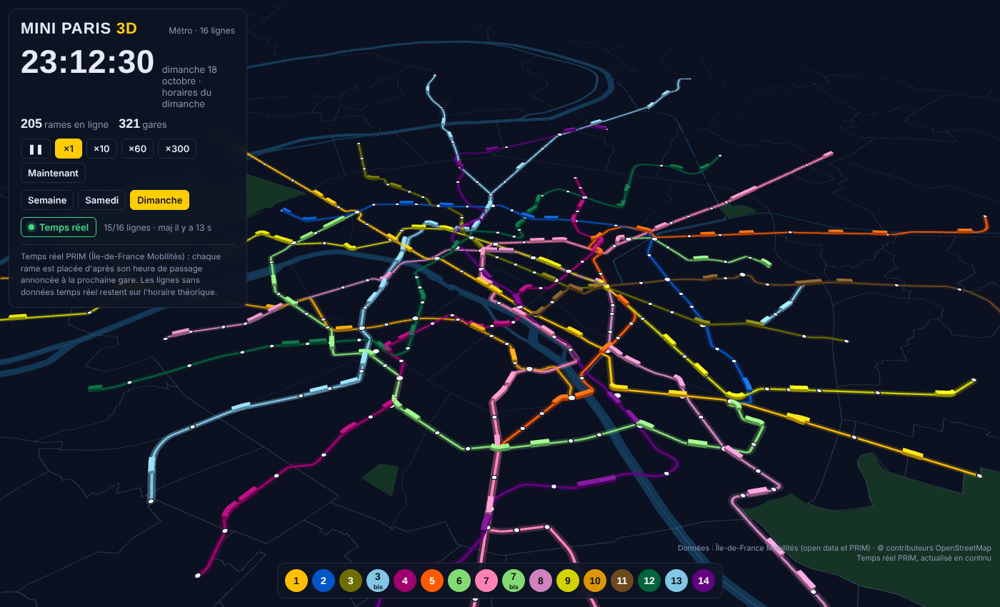

# Mini Paris 3D — le métro parisien en temps réel

Carte 3D animée des 16 lignes du métro parisien. Les rames circulent sur les tracés réels, selon les horaires
théoriques officiels d'Île-de-France Mobilités, ou en temps réel grâce à l'API PRIM.

> Ce projet s'inspire de **[Mini Tokyo 3D](https://minitokyo3d.com/)**, la carte 3D en temps réel des transports
> de Tokyo créée par Akihiko Kusanagi. Mini Paris 3D en reprend l'idée et l'adapte au métro parisien, avec ses
> propres données et sa propre chaîne de traitement.



**[Ouvrir la carte](https://mawa399.github.io/mini-paris-3d-metro/)** · [Comment ça marche](https://mawa399.github.io/mini-paris-3d-metro/comment-ca-marche.html) · [Version 1 (archivée)](https://mawa399.github.io/mini-paris-3d-metro/v1/)

## Nouveautés de la version 2

- **Fréquentation** : une colonne 3D par station, haute du nombre d'entrées pendant l'heure affichée (validations IDFM × profil horaire de la station). En accéléré, on voit l'heure de pointe se former.
- **Accessibilité en fauteuil roulant** : stations accessibles (vert), en partie (orange) ou non, ligne par ligne, d'après le GTFS IDFM.
- **Isochrones** : depuis une gare, à l'heure affichée, temps porte à porte en métro puis à pied (algorithme *Connection Scan*, 3 min par correspondance, marche à 4,5 km/h sur 1 km au plus), sur une grille de 150 m.
- **Voir la rue** : la photo de rue libre [Panoramax](https://panoramax.fr/) la plus proche (à 360° avec Pannellum), sinon un lien Google Street View.
- **Apparence** claire, sombre ou automatique (selon le lever et le coucher du soleil à l'heure affichée), avec `?theme=clair` ou `?theme=sombre` dans le lien.
- **Horaires mis à jour** (semaine du 24 novembre 2026).

La version 1 est conservée dans le dossier [`v1/`](v1/) et sous l'étiquette Git `v1.0`.

## Fonctionnalités

- **16 lignes, 321 gares** : tracés et gares issus de l'open data Île-de-France Mobilités.
- **Paris en 3D** : bâtiments extrudés selon leur hauteur réelle, rues, Seine, canaux et parcs (tuiles vectorielles OpenStreetMap, servies par OpenFreeMap), de nuit ou de jour.
- **Rames en 3D composées de voitures** : 6 voitures sur les lignes 1 et 4, 8 sur la 14, 3 sur les navettes 3bis et 7bis, 5 ailleurs. Elles suivent les courbes des voies, s'arrêtent à quai et accélèrent entre les gares.
- **Quais en 3D** dans chaque gare, visibles en zoomant.
- **Tableau des prochains départs** : un clic sur une gare affiche, ligne par ligne et par direction, les deux prochains passages (temps réel PRIM quand il est disponible, sinon horaires théoriques).
- **Suivre une rame** ou passer en **vue cabine** depuis sa fiche : la caméra accompagne la rame le long de sa ligne.
- **Horaires officiels** : environ 11 800 trajets un jour de semaine, 9 400 le samedi et 7 500 le dimanche, extraits du GTFS IDFM.
- **Info trafic** : état des 16 lignes (API PRIM « Perturbations »), halo orange ou rouge sur une ligne perturbée, anneau rouge sur une gare non desservie, message officiel au clic.
- **Fiche d'une rame** : direction et tous les prochains arrêts avec leur heure, annoncée par PRIM (en gras) ou estimée d'après l'horaire (~).
- **Sûr ou estimé** : quand le temps réel est actif, les rames annoncées par PRIM sont pleines, celles estimées d'après l'horaire sont pâles.
- **Recherche** d'une gare ou d'une ligne, et **liens partageables** : `?gare=chatelet`, `?ligne=14`.
- **Page « [Comment ça marche](comment-ca-marche.html) »** : données, méthode et limites.
- **Temps réel**, en ligne comme en local : chaque rame est placée d'après son heure de passage annoncée par PRIM à la prochaine gare.
- **Horloge** réglable (×1 à ×300), choix du type de jour (semaine, samedi, dimanche), filtre par ligne.
- **Fond de carte de secours embarqué** (Seine, Marne, canaux, bois, limites communales) : sans accès aux tuiles, la page fonctionne toujours.

## Lancer la carte

### En ligne

La page publiée sur GitHub Pages reçoit le temps réel par un petit relais
[Cloudflare Worker](relais-cloudflare/worker.js) : il interroge PRIM avec une clé gardée en secret côté
Cloudflare (jamais dans la page), garde chaque ligne en mémoire 60 s et renvoie le même JSON que le
serveur local, ainsi que les perturbations en cours sur le métro (relues toutes les 2 minutes).
Si le relais ne répond pas, la carte reste sur les horaires théoriques.

Pour déployer ton propre relais : crée un Worker à partir de `relais-cloudflare/worker.js`
(ou `npx wrangler deploy` dans ce dossier), ajoute le secret `PRIM_API_KEY`, puis indique son adresse
dans `RELAIS_URL` (scripts/template.html) et reconstruis `index.html`.

### En local avec le temps réel

Sous Windows, double-clique sur `lancer.bat` : il trouve Python, demande la clé PRIM la première fois
et ouvre la carte.

Il faut Python 3.9 ou plus, sans aucune bibliothèque à installer, et une clé API PRIM gratuite
(compte sur [prim.iledefrance-mobilites.fr](https://prim.iledefrance-mobilites.fr/)).

```bash
cp .env.example .env        # puis colle ta clé PRIM dans .env
python serveur.py           # ouvre ensuite http://localhost:8765
```

Le serveur interroge PRIM pour les 16 lignes en tâche de fond (un tour complet par minute par défaut,
réglable avec `--intervalle`) et transmet à la carte une version simplifiée des données. La clé reste
sur ta machine : le fichier `.env` est exclu du dépôt.

### Sans le temps réel

Ouvre simplement `index.html` dans un navigateur : la carte tourne sur les horaires théoriques.

## Reconstruire les données

```bash
pip install -r requirements.txt
python scripts/01_fetch_sources.py    # tracés, gares, GTFS (~160 Mo) et extraits OpenStreetMap
python scripts/02_build_network.py    # assemble les tronçons en itinéraires terminus → terminus
python scripts/03_build_basemap.py    # fond de carte : eau, bois, limites administratives
python scripts/04_extract_gtfs.py     # horaires du métro + correspondance quais → gares pour PRIM
python scripts/06_enrich.py           # fréquentation (validations IDFM) et accessibilité (GTFS)
python scripts/05_assemble.py         # produit index.html (page autonome)
```

| Dossier | Contenu |
| --- | --- |
| `data/sources/` | données brutes (le GTFS n'est pas versionné) |
| `data/build/` | données préparées pour la carte |
| `scripts/` | chaîne de traitement Python et gabarit de la page |

## Comment ça marche

1. **Réseau** : les 394 tronçons inter-gares d'IDFM sont regroupés en graphe par ligne (NetworkX), puis
   assemblés en itinéraires par plus court chemin entre terminus, branches comprises (lignes 7 et 13).
2. **Horaires** : le GTFS est lu en flux (13 millions de lignes d'horaires) pour ne garder que le métro.
   Les trajets sont compressés en motifs (suite de gares sur un tracé) et en profils horaires réutilisables.
3. **Position des rames** : entre deux gares, la position est interpolée le long du tracé GTFS avec une
   courbe d'accélération et de freinage.
4. **Temps réel** : pour chaque rame annoncée par PRIM, la carte retrouve le motif correspondant (ligne,
   terminus, gares annoncées) et en déduit le temps écoulé depuis le départ. Les doublons du flux sont fusionnés.
5. **Rendu** : [MapLibre GL JS](https://maplibre.org/) pour la ville (bâtiments en 3D à partir de leur hauteur OpenStreetMap), et [deck.gl](https://deck.gl/) par-dessus pour les voies, les quais et les rames, découpées en voitures le long du tracé.
6. **Gares et horaires** : les noms de gares diffèrent parfois entre le référentiel des gares et le GTFS (« Alma - Marceau » / « Alma-Marceau ») ; chaque arrêt des horaires est donc rattaché à la gare la plus proche de la même ligne, ce qui alimente le tableau des départs.

## Limites

- Les horaires théoriques sont ceux de la semaine du 24 novembre 2026 : relance la chaîne pour les mettre à jour.
- En temps réel, la position entre deux gares est estimée à partir de l'heure annoncée à la gare suivante.
- Le flux PRIM du métro donne les heures annoncées mais pas les heures prévues : on ne peut pas y mesurer un retard ; l'info trafic joue ce rôle.
- Une ligne sans données PRIM à un instant donné reste affichée sur l'horaire théorique.

## Inspiration

L'idée de ce projet vient de [Mini Tokyo 3D](https://minitokyo3d.com/) d'Akihiko Kusanagi
([code source sur GitHub](https://github.com/nagix/mini-tokyo-3d)) : une carte 3D où trains et avions de Tokyo
circulent en temps réel. Mini Paris 3D n'en reprend pas le code : il en transpose le principe à Paris, avec les
données d'Île-de-France Mobilités, un traitement en Python et un rendu deck.gl.

## Sources et licences des données

- Tracés, gares, horaires GTFS et temps réel PRIM : © Île-de-France Mobilités, voir les conditions de
  réutilisation indiquées sur [data.iledefrance-mobilites.fr](https://data.iledefrance-mobilites.fr/) et
  [prim.iledefrance-mobilites.fr](https://prim.iledefrance-mobilites.fr/).
- Fond de carte : © contributeurs [OpenStreetMap](https://www.openstreetmap.org/copyright), licence ODbL.

## Auteur

**Mawa Diaw**, géomaticien et développeur SIG ·
[LinkedIn](https://www.linkedin.com/in/mawa-diaw) · [GitHub](https://github.com/mawa399)
