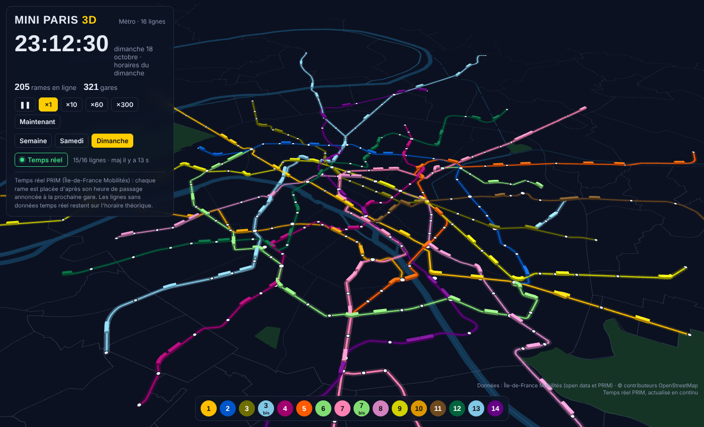

# Mini Paris 3D — le métro parisien en temps réel

Carte 3D animée des 16 lignes du métro parisien. Les rames circulent sur les tracés réels, selon les horaires
théoriques officiels d'Île-de-France Mobilités, ou en temps réel grâce à l'API PRIM.

> Ce projet s'inspire de **[Mini Tokyo 3D](https://minitokyo3d.com/)**, la carte 3D en temps réel des transports
> de Tokyo créée par Akihiko Kusanagi. Mini Paris 3D en reprend l'idée et l'adapte au métro parisien, avec ses
> propres données et sa propre chaîne de traitement.



## Fonctionnalités

- **16 lignes, 321 gares** : tracés et gares issus de l'open data Île-de-France Mobilités.
- **Horaires officiels** : environ 11 600 trajets un jour de semaine, 9 900 le samedi et 8 100 le dimanche, extraits du GTFS IDFM.
- **Temps réel** : avec le serveur local, chaque rame est placée d'après son heure de passage annoncée par PRIM à la prochaine gare.
- **Rames en 3D** aux couleurs officielles, qui suivent les courbes des voies, s'arrêtent à quai et accélèrent entre les gares.
- **Horloge** réglable (×1 à ×300), choix du type de jour (semaine, samedi, dimanche), filtre par ligne.
- **Fiche rame** au clic : direction, prochaine gare, heure d'arrivée prévue.
- **Fond de carte embarqué** (Seine, Marne, canaux, bois, limites communales) : la page fonctionne sans service de tuiles.

## Lancer la carte

### Avec le temps réel (recommandé)

Il faut Python 3.9 ou plus, sans aucune bibliothèque à installer, et une clé API PRIM gratuite
(compte sur [prim.iledefrance-mobilites.fr](https://prim.iledefrance-mobilites.fr/)).

```bash
cp .env.example .env        # puis colle ta clé PRIM dans .env
python serveur.py           # ouvre ensuite http://localhost:8000
```

Le serveur interroge PRIM pour les 16 lignes en tâche de fond (un tour complet par minute par défaut,
réglable avec `--intervalle`) et transmet à la carte une version simplifiée des données. La clé reste
sur ta machine : le fichier `.env` est exclu du dépôt.

### Sans le temps réel

Ouvre simplement `index.html` dans un navigateur : la carte tourne sur les horaires théoriques.

## Reconstruire les données

```bash
pip install -r requirements.txt
python scripts/01_fetch_sources.py    # tracés, gares, GTFS (~160 Mo) et extraits OpenStreetMap
python scripts/02_build_network.py    # assemble les tronçons en itinéraires terminus → terminus
python scripts/03_build_basemap.py    # fond de carte : eau, bois, limites administratives
python scripts/04_extract_gtfs.py     # horaires du métro + correspondance quais → gares pour PRIM
python scripts/05_assemble.py         # produit index.html (page autonome)
```

| Dossier | Contenu |
| --- | --- |
| `data/sources/` | données brutes (le GTFS n'est pas versionné) |
| `data/build/` | données préparées pour la carte |
| `scripts/` | chaîne de traitement Python et gabarit de la page |

## Comment ça marche

1. **Réseau** : les 394 tronçons inter-gares d'IDFM sont regroupés en graphe par ligne (NetworkX), puis
   assemblés en itinéraires par plus court chemin entre terminus, branches comprises (lignes 7 et 13).
2. **Horaires** : le GTFS est lu en flux (13 millions de lignes d'horaires) pour ne garder que le métro.
   Les trajets sont compressés en motifs (suite de gares sur un tracé) et en profils horaires réutilisables.
3. **Position des rames** : entre deux gares, la position est interpolée le long du tracé GTFS avec une
   courbe d'accélération et de freinage.
4. **Temps réel** : pour chaque rame annoncée par PRIM, la carte retrouve le motif correspondant (ligne,
   terminus, gares annoncées) et en déduit le temps écoulé depuis le départ. Les doublons du flux sont fusionnés.
5. **Rendu** : [deck.gl](https://deck.gl/) en WebGL, rames extrudées en 3D, vue inclinable et orientable.

## Limites

- Les horaires théoriques sont ceux de la semaine du 20 octobre 2026 : relance la chaîne pour les mettre à jour.
- En temps réel, la position entre deux gares est estimée à partir de l'heure annoncée à la gare suivante.
- Une ligne sans données PRIM à un instant donné reste affichée sur l'horaire théorique.

## Inspiration

L'idée de ce projet vient de [Mini Tokyo 3D](https://minitokyo3d.com/) d'Akihiko Kusanagi
([code source sur GitHub](https://github.com/nagix/mini-tokyo-3d)) : une carte 3D où trains et avions de Tokyo
circulent en temps réel. Mini Paris 3D n'en reprend pas le code : il en transpose le principe à Paris, avec les
données d'Île-de-France Mobilités, un traitement en Python et un rendu deck.gl.

## Sources et licences des données

- Tracés, gares, horaires GTFS et temps réel PRIM : © Île-de-France Mobilités, voir les conditions de
  réutilisation indiquées sur [data.iledefrance-mobilites.fr](https://data.iledefrance-mobilites.fr/) et
  [prim.iledefrance-mobilites.fr](https://prim.iledefrance-mobilites.fr/).
- Fond de carte : © contributeurs [OpenStreetMap](https://www.openstreetmap.org/copyright), licence ODbL.

## Auteur

**Mawa Diaw**, géomaticien et développeur SIG ·
[LinkedIn](https://www.linkedin.com/in/mawa-diaw) · [GitHub](https://github.com/mawa399)
